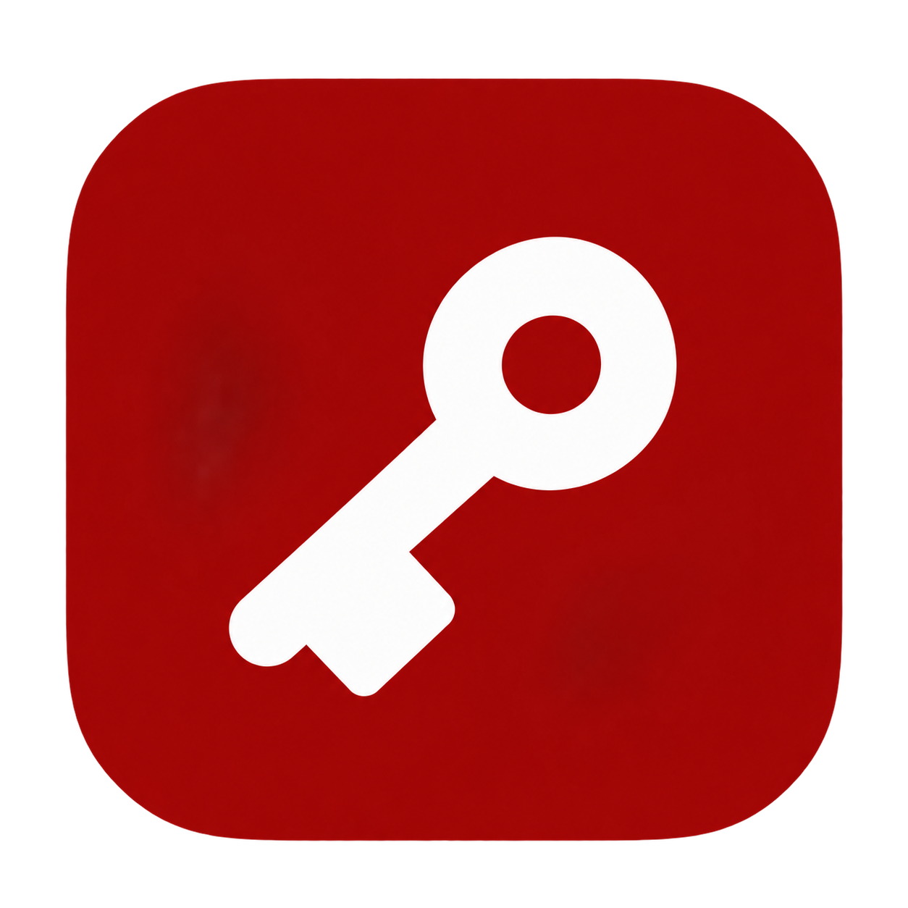
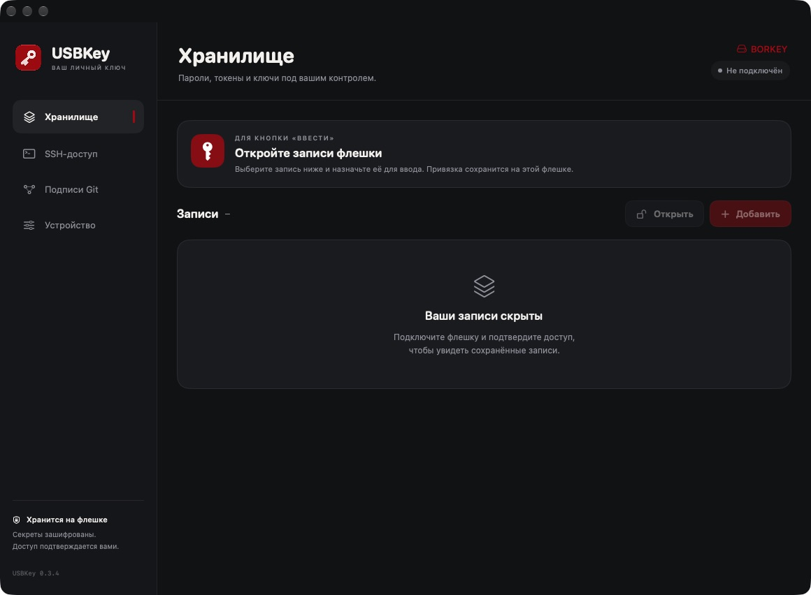
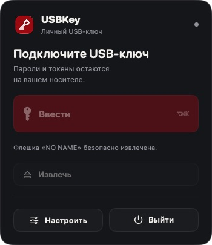
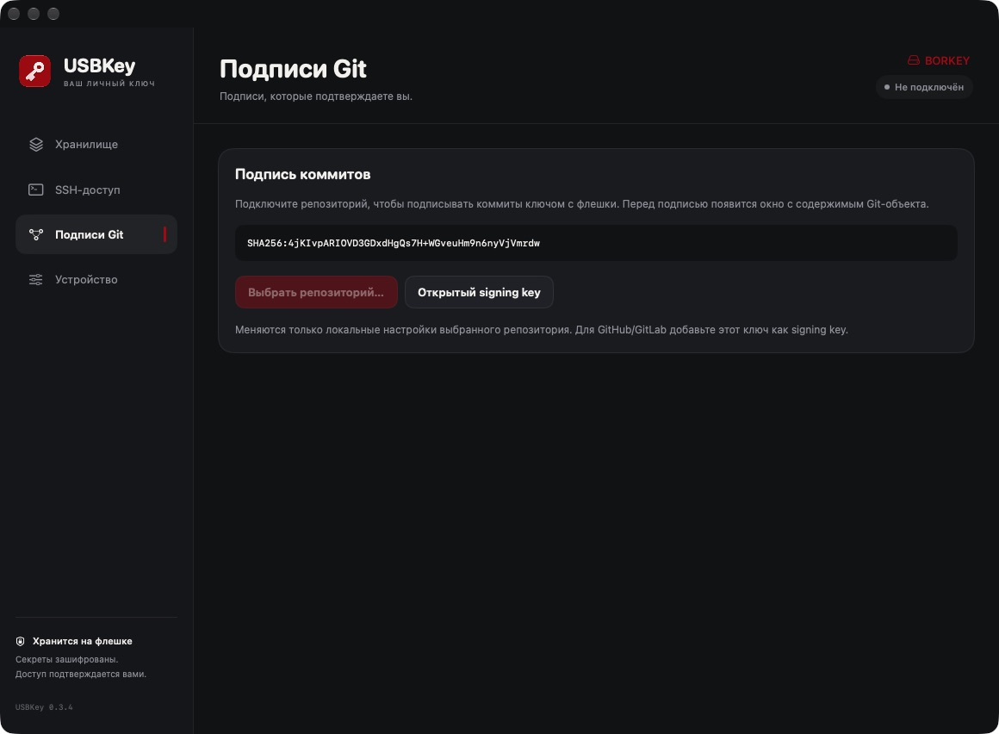
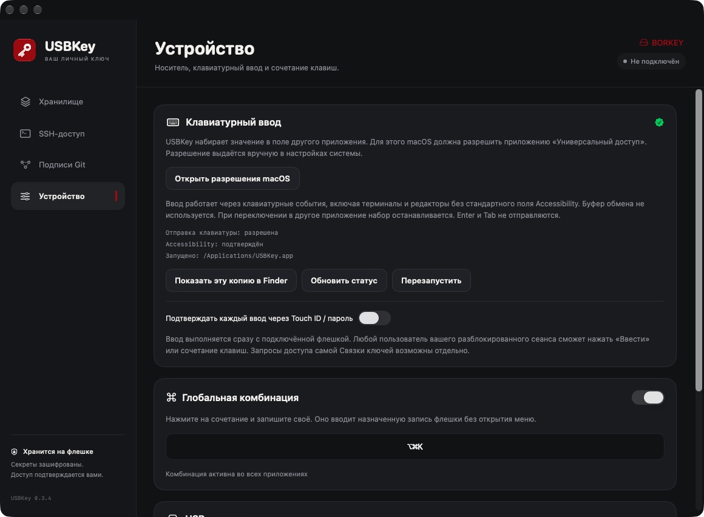

<div align="center">
  
  <h1>USBKey</h1>
  <p><strong>Пароли, SSH и подписи Git — с вашей USB-флешки.</strong></p>
  <p>Зашифрованное хранилище для macOS с быстрым вводом из строки состояния.</p>
  <p>
    
    
    
    
  </p>
  <p>
    <a href="#download">Скачать</a> ·
    <a href="#quick-start">Быстрый старт</a> ·
    <a href="#screenshots">Скриншоты</a> ·
    <a href="#build">Сборка</a> ·
    <a href="docs/GUIDE.md">Документация</a>
  </p>
  <br />
  
  <p><sub>Реальный интерфейс USBKey 0.3.4. Хранилище закрыто, носитель отключён.</sub></p>
</div>

## Ключ к повседневным действиям

USBKey превращает обычную флешку в носитель зашифрованных секретов. Сохраняйте несколько паролей, токенов и SSH-ключей, назначайте запись для быстрого ввода и используйте её из любого привычного рабочего приложения, которое принимает клавиатурные события.

- **Быстрый ввод.** Кнопка «Ввести» набирает назначенное значение в исходном приложении без буфера обмена и автоматического Enter.
- **Своя комбинация клавиш.** Вызывайте тот же ввод, не открывая меню. Привязка записи сохраняется на флешке.
- **SSH-доступ.** Встроенный агент Ed25519 отдаёт клиенту подпись; закрытый ключ используется внутри USBKey.
- **Подписи Git.** Подключайте репозитории и подтверждайте подписание каждого коммита в отдельном окне.
- **Подтверждение владельца.** Touch ID или пароль macOS для операций с хранилищем. Подтверждение каждого быстрого ввода настраивается отдельно.
- **Всегда под рукой.** Меню в строке состояния, запуск при входе, безопасное извлечение и обновление поверх старой версии.

> [!IMPORTANT]
> USBKey — программное решение для обычного USB-накопителя. Оно **не обеспечивает аппаратную некопируемость YubiKey** и не реализует FIDO2 / PIV. Приложение работает в пользовательском сеансе после входа в macOS и не разблокирует FileVault или экран входа.

<a id="screenshots"></a>

## Небольшое меню. Быстрый доступ.

Выбор и настройка записей находятся в основном окне. В меню остаются четыре действия: **ввести**, **извлечь**, **настроить**, **выйти**. Панель открывается под значком в текущем рабочем пространстве.

<p align="center">
  
</p>

<details>
  <summary><strong>Подписи Git — посмотреть экран</strong></summary>
  <br />
  
</details>

<details>
  <summary><strong>Разрешения, Touch ID и горячая клавиша — посмотреть экран</strong></summary>
  <br />
  
</details>

<a id="download"></a>

## Скачать

**[Перейти к релизам USBKey →](https://github.com/bordviz/usbkey/releases)**

Откройте последний релиз и в разделе **Assets** скачайте установщик **`USBKey-<версия>.pkg`**. Он подходит для Mac с Apple Silicon и Intel. Запустите скачанный `.pkg` и следуйте шагам установки.

Архивы **Source code (zip / tar.gz)** содержат исходный код. Для установки готового приложения выбирайте именно **`.pkg`**.

<a id="quick-start"></a>

## Начать пользоваться

### 1. Установите приложение

Скачайте установщик `.pkg` из [последнего релиза](https://github.com/bordviz/usbkey/releases/latest) и запустите его или [соберите его из исходников](#build). Приложение установится в `/Applications`, а в строке состояния появится значок ключа.

При обновлении установщик завершает старую копию и запускает новую. Сохранённые настройки, записи на флешке и привязки сохраняются.

### 2. Подготовьте флешку

Откройте **Настроить → Устройство**, выберите USB-накопитель и нажмите **«Подготовить новый USB-ключ…»**. Существующие файлы на носителе сохраняются.

В **Хранилище** добавьте пароль, токен, текстовую запись или SSH-ключ. Поддерживается до **100 записей** на носитель.

### 3. Назначьте запись для ввода

Откройте записи хранилища, выберите однострочный пароль или токен и нажмите **«Назначить для “Ввести”»**. Этот выбор сохранится в зашифрованном хранилище на самой флешке.

В разделе **Устройство** разрешите USBKey доступ к **Универсальному доступу** macOS. Если после изменения прав появится предложение перезапуска, нажмите **«Перезапустить»**.

### 4. Введите значение

Поставьте курсор в нужное поле, откройте меню USBKey и нажмите **«Ввести»**. Для ввода без меню включите свою глобальную комбинацию в настройках.

По умолчанию каждый ввод требует подтверждения Touch ID или паролем Mac. Эту проверку можно отключить: тогда ввод будет доступен в разблокированном сеансе при подключённой флешке.

<details>
  <summary><strong>Если доступ включён, но macOS продолжает запрещать ввод</strong></summary>

При переходе со старой ad-hoc подписи система может хранить разрешение для предыдущей сборки. Завершите USBKey, удалите старую строку в **Конфиденциальность и безопасность → Универсальный доступ**, добавьте именно `/Applications/USBKey.app` и запустите приложение заново.

В разделе **Устройство** показаны путь работающей копии и текущие состояния разрешений. Начиная с версии 0.3.2 локальные сборки используют постоянную подпись; обновляйте приложение с той же идентичностью.

[Подробнее о разрешениях и перезапуске →](docs/GUIDE.md#разрешение-включено-но-ввод-запрещён)

</details>

## Подписывать коммиты

1. В папке репозитория задайте имя и подтверждённый email своего аккаунта:

   ```sh
   git config --local user.name "Ваше имя"
   git config --local user.email "you@example.com"
   ```

2. Подключите флешку, выберите её в USBKey и откройте **Подписи Git → Выбрать репозиторий…**. Приложение включит автоматическое подписание только для этой папки.
3. Скопируйте **открытый signing key** и добавьте его в GitHub или GitLab с назначением **Signing**.
4. Создайте коммит обычной командой — USBKey предложит подтвердить подпись:

   ```sh
   git commit -m "Describe your changes"
   git verify-commit HEAD
   ```

Для Git используется основной ключ флешки. Запись, назначенная кнопке «Ввести», на подпись не влияет. Настройка подписи коммитов и SSH-аутентификация при `push` выполняются отдельно.

## Подключаться по SSH

Создайте отдельный Ed25519-ключ в хранилище либо импортируйте существующий **OpenSSH Ed25519 без парольного шифрования**. Скопируйте его открытый ключ в `~/.ssh/authorized_keys` на сервере.

Пока USBKey запущен и флешка подключена, используйте агент:

```sh
ssh -o IdentityAgent="$HOME/Library/Application Support/USBKey/agent.sock" user@server
```

Каждый запрос подписи требует подтверждения. Извлечение флешки блокирует новые подписи, но не разрывает уже установленные SSH-сессии.

[Настройка SSH, Git и локальной проверки подписей →](docs/GUIDE.md#ssh)

## Как защищены данные

**На флешке** хранятся зашифрованный основной ключ и зашифрованные записи. **В Связке ключей Mac** — отдельный случайный ключ расшифровки. Для шифрования используется **AES-256-GCM**, для подписей — **Ed25519** через CryptoKit.

Приложение проверяет UUID тома и серийный номер USB, если устройство его предоставляет. Закрытые ключи расшифровываются в памяти; значения записей не сохраняются открытыми во временные файлы.

У такой модели есть границы:

- UUID и серийный номер можно подделать; компрометация Mac или Keychain может раскрыть секреты.
- Перенос секретов на другой Mac и восстановление утраченного ключа в текущей версии не реализованы.
- Некоторые приложения и защищённые системные экраны блокируют синтетические клавиатурные события.
- SSH-агент пока не поддерживает привязку к удостоверенному имени сервера. Проверяйте host fingerprint в SSH-клиенте и не используйте agent forwarding.

[Модель защиты и подробности хранения →](docs/GUIDE.md#хранение)

<a id="build"></a>

## Собрать из исходников

Нужны **macOS 13+**, **Xcode / Command Line Tools**, **Swift 5.9+** и **Python 3**. Для SSH-подписей требуется **Git 2.34+** и OpenSSH с поддержкой `ssh-keygen -Y`.

```sh
# Один раз: создать постоянную локальную идентичность подписи.
python3 scripts/setup-local-signing.py

# Собрать приложение и PKG для Apple Silicon и Intel.
ARCHS=universal ./scripts/build.sh
```

Результат:

```text
dist/
├── USBKey.app
└── USBKey-0.3.5.pkg
```

Локальный сертификат сохраняет идентичность сборок для macOS. Это не Developer ID: для распространения через интернет нужны отдельная подпись установщика и нотариализация Apple.

[Локальная подпись, Developer ID и нотариализация →](docs/GUIDE.md#сборка)

## Проверка проекта


Тесты покрывают шифрование и подмену данных, хранение привязок, совместимость подписей с OpenSSH и Git, SSH-агент, Unicode-ввод, перезапуск и выбор носителя для извлечения. Для ввода используется фиктивный отправитель; реальные диски в тестах не извлекаются.

```sh
CLANG_MODULE_CACHE_PATH="$PWD/.build/module-cache" \
SWIFTPM_MODULECACHE_OVERRIDE="$PWD/.build/module-cache" \
swift test --disable-sandbox --build-system native
```

Интеграционный тест SSH использует временный Unix-сокет. Среда запуска должна разрешать его создание.

---

<p align="center">
  <strong>USBKey</strong><br />
  <sub>Ваши секреты. Ваш USB-ключ.</sub><br /><br />
  <a href="docs/GUIDE.md">Полное руководство</a> ·
  <a href="docs/GUIDE.md#обновление-поверх-старой-версии">Обновление</a> ·
  <a href="docs/GUIDE.md#удаление">Удаление</a>
</p>

### Встроенные инструкции

В каждом разделе приложения есть кнопка **«Как настроить»**. Для Git и SSH доступны пошаговые инструкции, открытый ключ выбранной флешки и блоки команд с кнопкой **«Копировать»**. Путь к SSH-агенту подставляется для текущего Mac. Команды выполняются пользователем вручную.
